<div align="center">

# 🌿 Nudge

### A gentle executive-function companion for neurodivergent students

**You're not lazy. Starting is just hard.**<br>
Nudge lowers the wall to starting, stays with you while you work, and makes rest guilt-free.


-6c5fa0?style=flat-square)


<br>

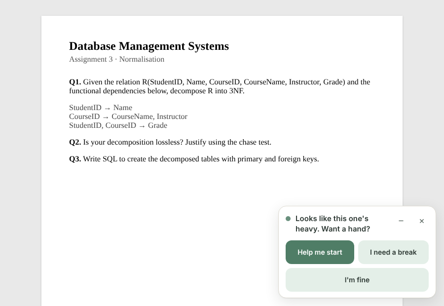

<sub>A nudge looks like this: small, in the corner, no sound, no red, and always easy to dismiss.</sub>

</div>

<br>

> [!NOTE]
> Nudge is a support tool, not medical treatment. If you're struggling, please reach out to someone you trust. In India, **Tele-MANAS** is free and runs 24×7: **14416** or **1-800-891-4416**.

---

## Contents

- [The problem](#-the-problem)
- [What Nudge does](#-what-nudge-does)
- [A walk through one evening](#-a-walk-through-one-evening)
- [The dashboard](#-the-dashboard)
- [How it works](#-how-it-works)
- [Privacy](#-privacy-by-design)
- [Safety](#-safety-layer)
- [Run it locally](#-run-it-locally-5-minutes)
- [Demo mode](#-demo-mode-for-judges)
- [Testing](#-testing)
- [Project structure](#-project-structure)
- [Design principles](#-design-principles)
- [Limits & roadmap](#-honest-limits--roadmap)

---

## 💭 The problem

It's 11:40 pm. `DBMS_Assignment.pdf` has been opened for the fifth time. Instagram, back, YouTube, back. The student cares a lot about this assignment. They're **stuck**, which is task paralysis: the executive-function wall many ADHD and autistic students hit at the *start* of a task.

Most productivity tools make this worse: red "overdue" badges, streaks that break, nagging notifications. For someone with rejection sensitivity, every one of those lands as *"you're failing"*.

**Nudge takes the opposite approach.** It offers one tiny step at a time and keeps you company while you do it. Rest counts as part of the plan, and nothing you leave unfinished is held against you.

---

## ✨ What Nudge does

<table>
<tr>
<td width="33%" valign="top">

### 🧱 Lowers the wall
Press **Ctrl+Shift+Space** and say or type what's hard. You get **one micro-step under 2 minutes**, small enough to feel almost silly. Five big buttons are always there: **Done · Too much · Make it smaller · Different idea · I need rest**.

</td>
<td width="33%" valign="top">

### 🤝 Stays with you
**Body-double mode** shows a calm ring timer, optional brown noise or rain, and an occasional *"still here with you"*. If you drift, a tiny chip asks *"Still going, or stuck again?"* and picks up from your last finished step, without ever commenting on the stall.

</td>
<td width="33%" valign="top">

### 🌙 Makes rest real
**I need a break** offers 5 min, 15 min or *Done for today*. Done for today leaves a note for future-you. When you come back, there's no guilt, just *"Welcome back. Want to start fresh?"*

</td>
</tr>
<tr>
<td valign="top">

### 🧠 Learns what works for *you*
After each idea you can tap 👍 or 👎. **Thompson sampling** learns which of the 62 strategies help *you* while still trying new ones now and then, so favourites don't wear out.

</td>
<td valign="top">

### 👀 Notices, gently
Nudge senses metadata only and compares it with *your* baseline. It recognises **flow** (never interrupted), **stuck**, **running low** and **away**. Every guess comes with a plain-English reason and **Right / Wrong** buttons.

</td>
<td valign="top">

### 🔒 Private by design
No page content, keystrokes, audio or webcam. Raw events are deleted every 30 seconds. The AI runs on **your machine** by default, and help still works fully offline.

</td>
</tr>
</table>

---

## 🌆 A walk through one evening

<table>
<tr>
<td align="center" width="25%">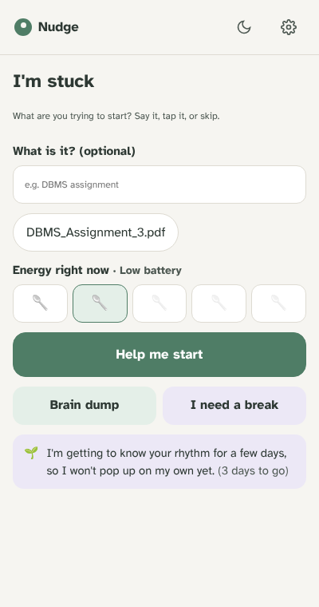<br><sub><b>1. "I'm stuck"</b><br>Say it, tap it, or skip it.</sub></td>
<td align="center" width="25%">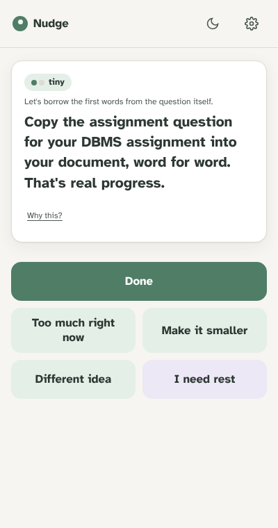<br><sub><b>2. One tiny step</b><br>Always five big choices.</sub></td>
<td align="center" width="25%">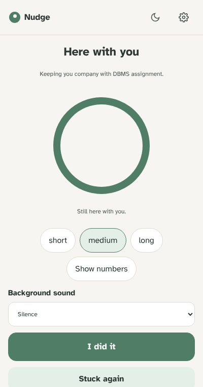<br><sub><b>3. Body double</b><br>A calm presence, not a stopwatch.</sub></td>
<td align="center" width="25%">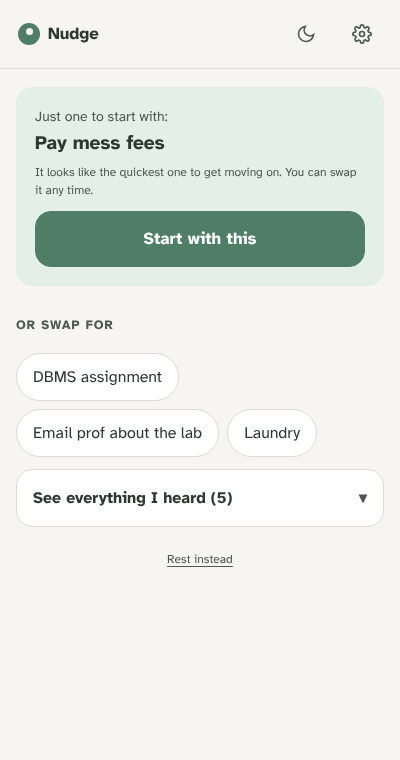<br><sub><b>4. Brain dump</b><br>Ramble; Nudge picks just one.</sub></td>
</tr>
<tr>
<td align="center">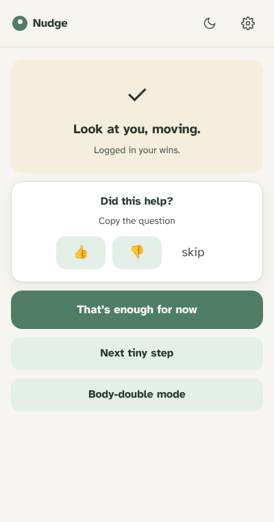<br><sub><b>5. Every attempt counts</b><br>A gentle 👍 / 👎 to learn.</sub></td>
<td align="center">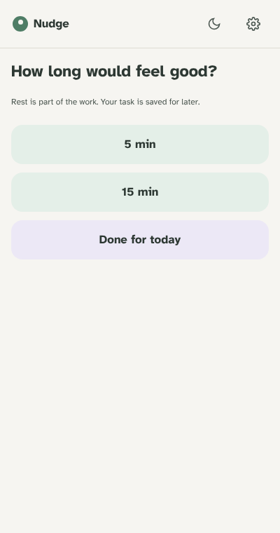<br><sub><b>6. Guilt-free rest</b><br>Rest is part of the plan.</sub></td>
<td align="center">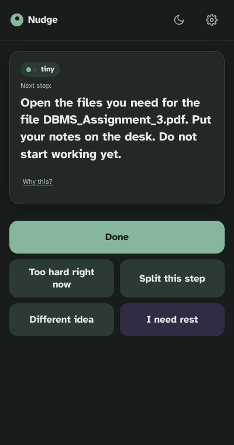<br><sub><b>7. Clear & literal mode</b><br>Exact names, no metaphors.</sub></td>
<td align="center">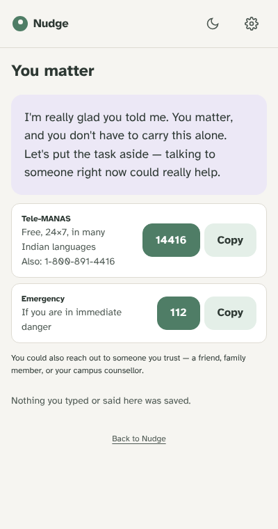<br><sub><b>8. Safety first</b><br>Coaching stops; nothing is saved.</sub></td>
</tr>
</table>

<details>
<summary><b>Same task, two wording styles</b></summary>

<br>

| Warm & casual | Clear & literal |
|---|---|
| *"Just open DBMS_Assignment.pdf. That's the whole step. Looking at it is optional."* | *"Open the file DBMS_Assignment.pdf. You do not need to do anything else."* |
| *"Let's make a gloriously ugly first sentence for your essay."* | *"Type one sentence about your essay. Spelling and quality do not matter."* |
| *"For the laundry, handle just one item — one sock, one dish."* | *"Pick up one item for the laundry and put it where it belongs."* |

Every one of the 62 strategy cards has a hand-written literal version. In literal mode, AI replies containing idioms are retried, and if they still contain one they're replaced with the literal card.

</details>

---

## 📊 The dashboard

A calm overview, running locally at `localhost:3000`. It reads your data straight from the extension and never sends it to a server.

<table>
<tr>
<td width="50%">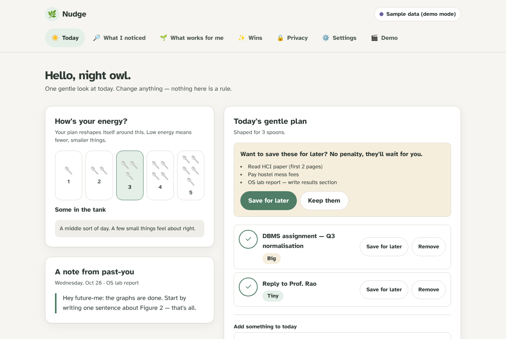<br><sub><b>Today</b>: the energy dial reshapes the plan. At low energy you get fewer, smaller items, and moving the rest is only <i>offered</i>, never forced.</sub></td>
<td width="50%">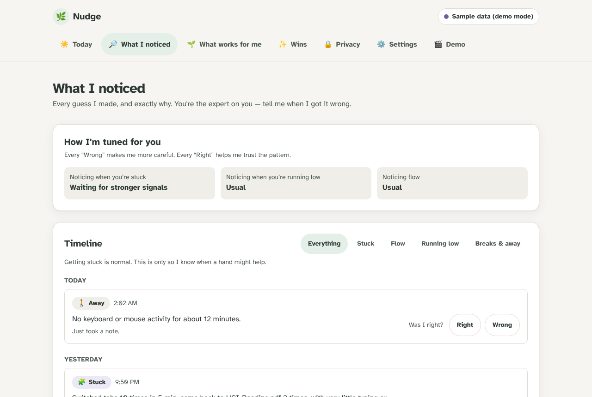<br><sub><b>What I noticed</b>: every guess with its reason. Tapping <i>Wrong</i> makes Nudge wait for stronger signals next time.</sub></td>
</tr>
<tr>
<td>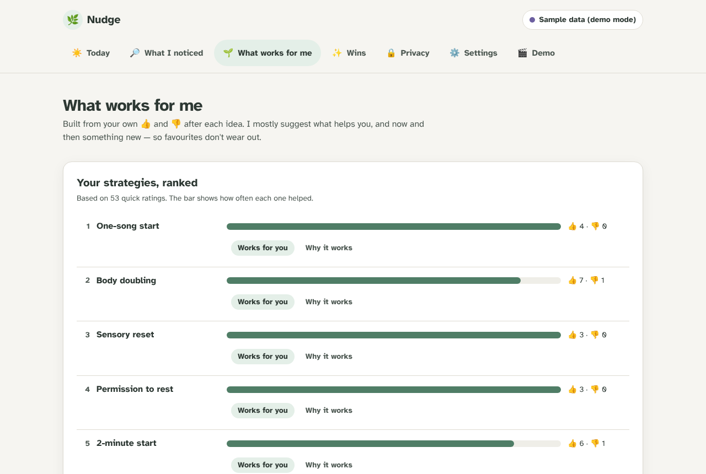<br><sub><b>What works for me</b>: strategies ranked by <i>your</i> 👍 and 👎.</sub></td>
<td>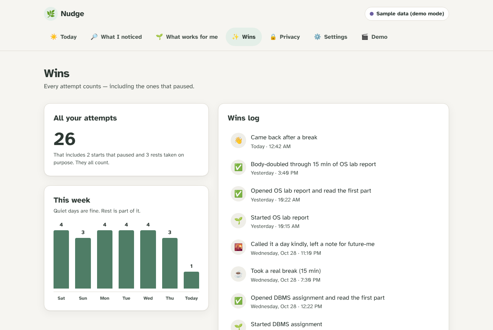<br><sub><b>Wins</b>: every attempt counts, including paused starts and rests. Themes unlock as you go and are never lost.</sub></td>
</tr>
</table>

---

## ⚙️ How it works

### The three apps

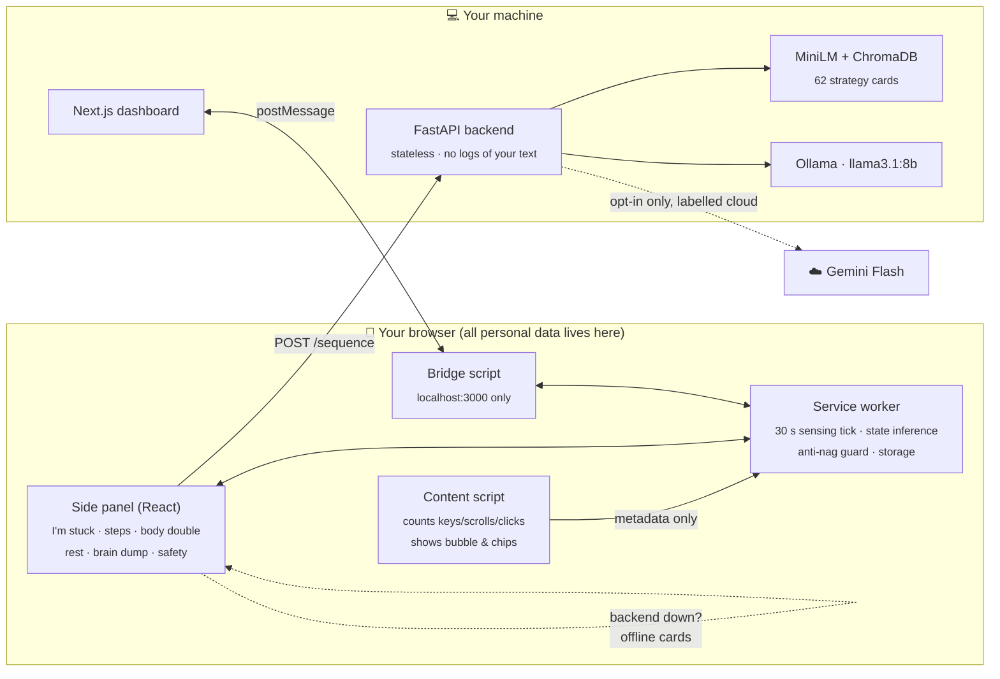

### From "I'm stuck" to one tiny step

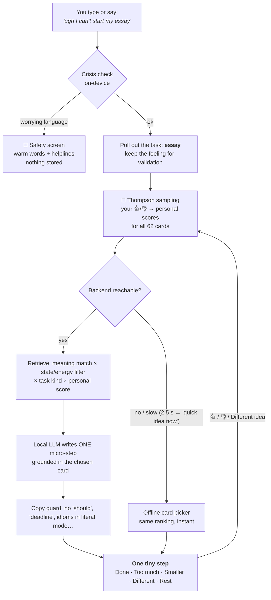

### Sensing and states, judged against *your* baseline

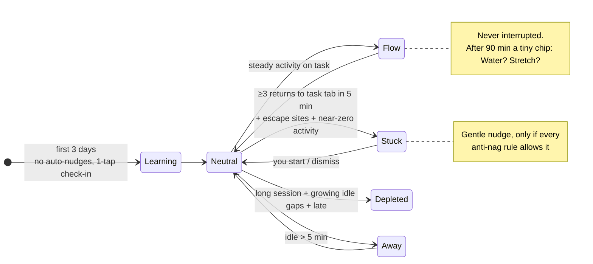

Switching between work sites (docs, LMS, Stack Overflow, GitHub, lecture videos) is **never** counted as stuck. Every guess is logged with a reason such as *"Switched tabs 14 times in 5 min, came back to DBMS_Assignment.pdf 4 times."*

### Anti-nag safeguards (designed for rejection sensitivity)

| Rule | Behaviour |
|---|---|
| ⏱️ Rate limit | At most **1 auto-nudge per 20 min** |
| 🙅 "I'm fine" | Each one **doubles** the cooldown |
| 🌙 Three dismissals | Auto-nudges rest **until tomorrow**, with a kind message |
| 🦉 Night owls | The day rolls over at **05:00**, not midnight, and quiet choices last at least 4 h |
| 🎬 Auto-silence | Flow, fullscreen, video calls, quiet hours, do-not-disturb, breaks, "Done for today" |
| 🌱 Learning mode | No auto-nudges for the first 3 days while Nudge learns your baseline |
| 🎨 Tone | No sound by default, never red, never covers content; unfinished work is *"saved for later"* |

---

## 🔒 Privacy by design

| ✅ Nudge tracks (metadata only) | ❌ Nudge never tracks |
|---|---|
| Tab switches per minute | Page content or full URLs (hostname only) |
| Returns to your pinned task tab | Keystroke values (only a *count*) |
| Key / scroll / click **counts** per tab | Audio (transcribed, then dropped; never stored) |
| Idle gaps, session length, hour of day | Webcam |
| Domain category: work / escape / neutral | Anything in incognito |

- **Where data lives:** `chrome.storage.local` in your browser. Raw events are deleted every 30 seconds.
- **AI:** runs locally through Ollama by default. Gemini is used **only** with `NUDGE_ALLOW_CLOUD=1` and an API key, and is labelled as cloud in the Privacy center.
- **Voice:** on-device speech first, then local Whisper. Chrome's cloud speech is used only if you opt in, with a clear label.
- **Dashboard:** pause tracking, per-site exclusions, export everything as JSON, delete everything.
- **Honest scope:** browser only. Phone distractions aren't tracked; a phone companion with the same privacy model is on the roadmap.

---

## 💜 Safety layer

Every typed or spoken message is checked for crisis language **before** any coaching:

1. **On-device patterns** (`shared/src/crisis.ts`) run first, even offline.
2. **The same patterns on the backend.** They're generated from one source file (`backend/app/crisis_patterns.py`), so the two layers can't drift apart.
3. **A meaning-based safety net** (MiniLM) compares each sentence with crisis examples and with ordinary study-stress examples. It catches paraphrases no pattern lists.

When something is detected:
- Task coaching stops.
- A warm message appears with helplines for your region, with tap-to-call and copy buttons (India: Tele-MANAS **14416**).
- Nothing is stored, and the text is never used as a task.

Everyday hyperbole is understood as everyday talk: *"this assignment is killing me"*, *"dead tired"*, *"kill the process"*. For gentler phrasings there's an *"I'm safe — just really frustrated"* option.

> [!IMPORTANT]
> No automatic check is perfect. On new, untuned wordings, the patterns alone catch roughly 70%, and about 82% with the meaning-based layer. That's why helpline numbers are always reachable in Settings, whatever detection does.

---

## 🚀 Run it locally (5 minutes)

**You need:** Google Chrome, [Node.js 18+](https://nodejs.org), [Python 3.10+](https://python.org) and git.

```bash
git clone https://github.com/atharvb7/Vijaybhoomi-hackathon.git
cd Vijaybhoomi-hackathon

./scripts/run-local.sh --ml                                   # macOS / Linux
powershell -ExecutionPolicy Bypass -File scripts\run-local.ps1 -Ml   # Windows
```

The script installs everything, builds the extension, and starts the **backend** (`:8000`) and the **dashboard** (`:3000`). Leave `--ml` off to skip the ~1 GB semantic-search download; everything still works.

Then load the extension once:

1. Open `chrome://extensions` and turn on **Developer mode**.
2. Click **Load unpacked** and choose the `extension/dist` folder.
3. Pin 🌿 Nudge, then press **Ctrl+Shift+Space** (⌘+Shift+Space on Mac).

<details>
<summary><b>Optional: local AI with Ollama</b></summary>

```bash
ollama pull llama3.1:8b      # then restart the script
```

Without Ollama, Nudge uses its 62 hand-written strategy cards. Every feature still works, and Settings shows which mode you're in.

</details>

<details>
<summary><b>Manual setup (no script)</b></summary>

```bash
npm install
npm run build -w extension                       # → extension/dist
cd backend && python3 -m venv .venv
.venv/bin/pip install -r requirements-dev.txt -r requirements-ml.txt
.venv/bin/uvicorn app.main:app --port 8000 --no-access-log
# new terminal
npm run build -w dashboard && npm run start -w dashboard   # must be port 3000
```

</details>

📖 **[docs/TRY_IT.md](docs/TRY_IT.md)** has a 10-minute guided tour of every feature, plus troubleshooting.

---

## 🎬 Demo mode (for judges)

You don't need to wait 3 days for learning mode. In the side panel, go to **⚙ Settings → Demo mode**:

| Button | What you'll see |
|---|---|
| **Load 1-week sample history** | Personal learning, "What I noticed" and wins fill with realistic data |
| **Simulate stuck** | The calm bubble: *"Looks like this one's heavy. Want a hand?"* |
| **Simulate re-stuck** | The chip *"Still going, or stuck again?"* (resumes from your last step) |
| **Simulate depleted** | A rest-first nudge |
| **Simulate long break** | *"Want to come back, or call it a day? Both are fine."* |
| **Simulate crisis phrase** | The safety screen. Nothing is stored. |

<p align="center">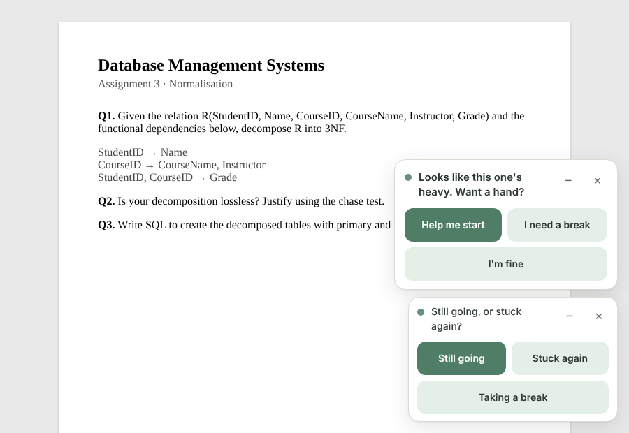</p>

The full pitch script is in **[docs/PITCH.md](docs/PITCH.md)**.

---

## 🧪 Testing

| Suite | What it covers | Result |
|---|---|---|
| `shared` (vitest) | Sensing, anti-nag guard, Thompson sampling, offline picker, grammar of every card × task, crisis set | **542 ✓** |
| `extension` (vitest) | Session state, panel restore, plan sync | **40 ✓** |
| `backend` (pytest) | API, safety (289 crisis / 160 safe phrasings), fake-LLM pipeline, robustness, help quality | **801 ✓** |
| `smoke.cjs` | Real extension in Chromium, backend down **and** up | **21/21 ✓** |
| `edge.cjs` | Anti-nag, sensing, keyboard, a11y, awkward pages | **53/53 ✓** |
| `trust.cjs` | Crisis never becomes a task, slow backend, hotkey keeps place, restore | **22/22 ✓** |
| `e2e/full.cjs` | Backend + dashboard + extension together, hostile pages, 5k items, axe, 390 px | **43/43 ✓** |
| `copy-lint` | No *should / overdue / deadline / streak / fail* anywhere in the UI | **✓** |

```bash
npm run test -w shared && npm run test -w extension
(cd backend && .venv/bin/python -m pytest -q)
node scripts/copy-lint.mjs
npm run e2e                       # needs Playwright: npm i --no-save playwright && npx playwright install chromium
node scripts/screenshots.cjs      # regenerates the README screenshots
```

---

## 🗂️ Project structure

```
.
├── extension/   Chrome MV3 · React + Vite + TS
│   ├── src/background/   service worker: sensing tick, inference, guard, nudges, bridge
│   ├── src/content/      metadata counter + shadow-DOM bubble/chips · dashboard bridge
│   └── src/panel/        side panel: onboarding, I'm stuck, steps, body double, rest, safety, settings, demo
├── backend/     FastAPI · stateless
│   └── app/              sequencer, retrieval (MiniLM+Chroma / TF-IDF), ranking, LLM (Ollama → Gemini → cards),
│                         safety + crisis_patterns, copy_guard, task kinds, transcribe (whisper.cpp)
├── dashboard/   Next.js 14 · Tailwind · Today, What I noticed, What works, Wins, Privacy, Settings, Demo
├── shared/      @nudge/shared · types, 62 strategy cards, core logic, design tokens (used by extension + dashboard)
├── e2e/         full-system Playwright suite
├── scripts/     run-local.sh / .ps1 · copy-lint · screenshots
└── docs/        ARCHITECTURE · RESEARCH · PITCH · TRY_IT · images/
```

---

## 🧭 Design principles

- **The user is never lazy.** Copy is gentle, choice-based and short. Five words are banned (*should, overdue, deadline, streak, fail*), and a lint enforces it.
- **No red, ever.** Calm sage, lavender and sand. Rest is a first-class button on every screen.
- **Choices, not commands.** Helps demand-avoidant users: *"Want to try this?"* rather than *"Do this."*
- **Literal mode for autistic users.** Exact names and actions, and buttons named exactly as they appear.
- **Time you can see.** Shrinking rings and colour fades; steps are labelled *tiny* or *small*, not timed in minutes.
- **Accessible by default.**
  - Atkinson Hyperlegible, with a dyslexia-friendly Lexend option.
  - Text size, high contrast and reduced motion settings.
  - 48 px targets and full keyboard support.
  - Screen-reader labels, checked with axe.

The evidence and sources behind each choice are in **[docs/RESEARCH.md](docs/RESEARCH.md)**. Contracts between the apps are in **[docs/ARCHITECTURE.md](docs/ARCHITECTURE.md)**.

---

## 🛣️ Honest limits & roadmap

- **Crisis detection** is a safety net, not a guarantee. **Next:** a small trained classifier, evaluated on consented data.
- **Browser only.** **Next:** a phone companion with the same metadata-only privacy model.
- **Voice** depends on on-device speech support in your Chrome version, or a local Whisper setup.
- **Real-model quality** has been tested against a scripted fake model. Try it with Ollama on your machine.
- **Insights slide** (`/insights`) is a template waiting for **real, consented interview quotes**. We never invent them.

<div align="center">
<br>

**Built with care for the students who are trying harder than it looks.** 🌿

<sub>Nudge is a support tool, not medical treatment.</sub>

</div>
